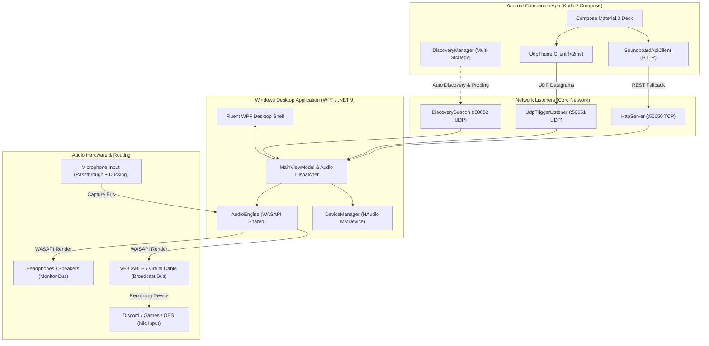

# LameSounds

<p align="center">
  
</p>

<p align="center">
  <strong>Ultra Low-Latency Cross-Platform Soundboard & Mobile Deck Suite</strong>
</p>

<p align="center">
  <a href="#features"></a>
  <a href="#architecture"></a>
  <a href="#android-mobile-deck"></a>
  <a href="#audio-engine"></a>
  <a href="#networking--wireless-pairing"></a>
  <a href="#license"></a>
</p>

---

## Table of Contents

- [Overview](#overview)
- [Key Features](#key-features)
- [Architecture & Tech Stack](#architecture--tech-stack)
- [Networking & Wireless Pairing](#networking--wireless-pairing)
- [System Requirements & Prerequisites](#system-requirements--prerequisites)
- [Installation Guide](#installation-guide)
  - [Windows Desktop Application](#windows-desktop-application)
  - [Virtual Audio Cable Setup (Discord / Games / OBS)](#virtual-audio-cable-setup-discord--games--obs)
  - [Android Companion App](#android-companion-app)
- [User Guide & Workflows](#user-guide--workflows)
  - [Audio Mixer & Dual Routing](#1-audio-mixer--dual-routing)
  - [Organizing Sound Sets & Drag-and-Drop](#2-organizing-sound-sets--drag-and-drop)
  - [Importing & Managing Audio](#3-importing--managing-audio)
  - [Wireless Pairing Options](#4-wireless-pairing-options)
- [Configuration & Data Storage](#configuration--data-storage)
- [Troubleshooting & FAQ](#troubleshooting--faq)
- [Contributing & Development](#contributing--development)
- [License](#license)

---

## Overview

**LameSounds** is an ultra-low latency, hardware-accelerated soundboard designed for competitive gamers, streamers, and podcasters. It provides a dual-interface experience:

1. **Windows 11 Desktop Application**: A dark-themed, Fluent WPF interface featuring real-time VU audio metering, dual-bus routing (Monitor + Virtual Mic Cable), microphone passthrough with auto-ducking, and global hotkey bindings.
2. **Android Mobile Companion Deck**: A Jetpack Compose tactile soundboard deck that connects wirelessly to your PC over local Wi-Fi or Mobile Hotspot, allowing you to trigger sounds, adjust volumes, and manage sound sets with sub-2 millisecond latency—turning your smartphone into a dedicated sound deck without spending hundreds on dedicated hardware.

---

## Key Features

### Pro-Grade Audio Pipeline
- **Dual-Bus Audio Engine**: Simultaneously outputs audio to your **Monitor** (Headphones/Speakers) and a **Broadcast** endpoint (VB-Audio Virtual Cable, VoiceMeeter, or VAC).
- **WASAPI Shared Mode with Auto-Resampling**: Native Windows Audio Session API running at 48,000 Hz 32-bit IEEE float. Automatically handles sample-rate conversion (via WDL resampler) and multi-channel channel mapping (mono, stereo, 5.1/7.1 surround).
- **In-Memory Zero-Latency Cache**: Audio clips are pre-decoded into memory buffers, eliminating mechanical disk spin-up and file read delays during high-stakes gaming moments.
- **Smart Mic Passthrough & Auto-Ducking**: Streams your microphone directly into your virtual broadcast cable while automatically ducking your voice whenever soundboard effects are triggered.

### Android Mobile Companion Deck
- **Zero-Config Wireless Discovery**: Instantly discovers the PC application using multi-subnet UDP discovery beacons, broadcast probing, Windows Mobile Hotspot gateway auto-detection, and QR code visual pairing.
- **Ultra-Fast UDP Triggering**: Triggers audio in less than 2 milliseconds over UDP datagrams with seamless HTTP fallback for isolated or restricted networks.
- **Interactive Drag-and-Drop Reordering**: Long-press any sound button to lift and drag it into new grid slots with spring physics and smooth grid animations.
- **Always-Awake Ergonomics**: Keeps the mobile screen alive (`FLAG_KEEP_SCREEN_ON`) during intense gaming sessions with integrated haptic feedback on sound triggers.
- **Bidirectional Volume & State Sync**: Adjust PC master speaker volume and virtual mic output volume directly from mobile sliders with real-time feedback.

---

## Architecture & Tech Stack



### Component Breakdown

| Module | Technologies | Description |
| :--- | :--- | :--- |
| **`LameSounds.App`** | .NET 9, WPF, C#, XAML | Windows 11 Fluent dark UI desktop application, tray integration, hotkey handlers, and UI state management. |
| **`LameSounds.Core`** | NAudio, WASAPI, QRCoder, System.Text.Json | Multi-stream audio engine, device enumeration, embedded zero-admin HTTP server, and UDP listeners. |
| **`android`** | Kotlin 2.0, Jetpack Compose, OkHttp, Coroutines | Material 3 mobile deck, auto-discovery engine, UDP client, and gesture-driven drag-and-drop grid. |
| **`LameSounds.Tests`** | xUnit, .NET 9 | Unit tests covering audio format conversion, cached sample providers, and network packet parsing. |

---

## Networking & Wireless Pairing

LameSounds uses standard, lightweight networking protocols designed to work without administrator privileges or Windows URLACL permissions:

| Port | Protocol | Purpose | Description |
| :--- | :--- | :--- | :--- |
| **`50050`** | **TCP (HTTP)** | REST API & Companion Sync | Supplies sound metadata, audio file sync, volume controls, and device status. |
| **`50051`** | **UDP** | Ultra-Low Latency Triggers | Fires zero-overhead playback commands (`play`, `stop`, `volume`) in `< 2ms`. |
| **`50052`** | **UDP** | Beacon & Discovery Probing | Broadcasts presence across all local subnets and listens for `whois_soundboard` probes. |

### Wireless Discovery Hierarchy
The Android app resolves the desktop server using a 5-step fallback strategy:
1. **Saved Host**: Tries the last successfully connected IP address stored in preferences.
2. **Windows Mobile Hotspot**: Probes the standard Windows hotspot gateway (`192.168.137.1`).
3. **Wi-Fi DHCP Gateway**: Probes the current router gateway IP address.
4. **Multi-Subnet UDP Broadcast**: Transmits broadcast probe packets (`255.255.255.255:50052`) and receives direct IP replies.
5. **Subnet Sweep**: Scans active local `/24` subnet IP candidates concurrently in batched coroutines.

---

## System Requirements & Prerequisites

### Windows PC
- **OS**: Windows 10 (version 1809+) or Windows 11 (64-bit recommended).
- **Framework**: [.NET 9.0 Runtime](https://dotnet.microsoft.com/download/dotnet/9.0) (included in the self-contained standalone executable).
- **Virtual Audio Device (Recommended)**: [VB-Audio Virtual Cable](https://vb-audio.com/Cable/) (Free) or [VoiceMeeter](https://vb-audio.com/Voicemeeter/) to broadcast audio into games, Discord, or OBS.

### Android Device
- **OS**: Android 8.0 (Oreo, API level 26) or higher.
- **Connection**: Wi-Fi (connected to the same local network as the PC) or connected directly to the PC's **Windows Mobile Hotspot**.

---

## Installation Guide

### Windows Desktop Application

#### Option A: Run Pre-Built Executable (Fastest)
1. Clone or download the repository:
   ```cmd
   git clone https://github.com/vanshtyagi001/lame-sounds.git
   cd lame-sounds
   ```
2. Double-click **`run.bat`** in the project root.
   - `run.bat` automatically locates the latest release build or standalone executable and launches the desktop app.
3. Alternatively, run the standalone single-file binary directly:
   ```cmd
   publish\standalone\LameSounds.App.exe
   ```

#### Option B: Build From Source (.NET CLI)
Ensure you have the [.NET 9 SDK](https://dotnet.microsoft.com/download/dotnet/9.0) installed:
```powershell
# Restore dependencies and build in Release mode
dotnet build src/LameSounds.App/LameSounds.App.csproj -c Release

# Publish a single-file standalone distribution
dotnet publish src/LameSounds.App/LameSounds.App.csproj -c Release -r win-x64 --self-contained true -p:PublishSingleFile=true -o publish/standalone
```

---

### Virtual Audio Cable Setup (Discord / Games / OBS)

To route soundboard audio so teammates and stream viewers can hear it:

```
[ LameSounds Soundboard ] 
      │
      ├───► [ Headset / Speakers ] ────────► You hear the sounds
      │
      └───► [ CABLE Input (VB-Audio) ] ───► Transmits audio
                   │
                   ▼
     [ Discord / Game / OBS Input ] ◄───── Others hear the sounds
```

1. **Install Virtual Cable**: Download and install [VB-Audio Virtual Cable](https://vb-audio.com/Cable/). Reboot your PC if prompted.
2. **Configure LameSounds**:
   - Open **LameSounds Desktop**.
   - Navigate to the **Audio Mixer** tab in the left sidebar.
   - Set **Monitor Device** to your physical headphones/speakers (e.g., `Headphones (Realtek Audio)`).
   - Set **Broadcast Device** to `CABLE Input (VB-Audio Virtual Cable)`.
   - Set **Microphone Device** to your physical microphone (e.g., `Microphone (Realtek Audio)`).
   - Enable **Mic Passthrough** if you want your voice and soundboard audio mixed into the same single cable.
3. **Configure Discord / Game / OBS**:
   - In Discord (**Settings > Voice & Video**) or in your game's audio settings:
   - Set **Input Device** to **`CABLE Output (VB-Audio Virtual Cable)`**.
   - Disable *Noise Suppression* (Krisp) or set it to *Standard* to prevent Discord from filtering out meme sounds.

---

### Android Companion App

#### Option A: Install via Gradle (Developer Setup)
1. Connect your Android phone to your PC via USB with **USB Debugging** enabled.
2. Open a terminal in the `android/` directory and execute:
   ```cmd
   cd android
   gradlew.bat installDebug
   ```
3. The app will compile and install directly onto your device.

#### Option B: Build APK Manually
```cmd
cd android
gradlew.bat assembleDebug
```
The compiled APK will be located at:
`android/app/build/outputs/apk/debug/app-debug.apk`. Transfer and install it on your device.

---

## User Guide & Workflows

### 1. Audio Mixer & Dual Routing

Navigate to the **Audio Mixer** tab on Windows to fine-tune your setup:

- **Monitor Volume**: Adjusts how loud soundboard audio plays in your own ears.
- **Broadcast Volume**: Controls the volume sent to Discord/teammates via the virtual cable.
- **Microphone Passthrough**: Routes your real microphone through the virtual cable so you only need one input device in Discord.
- **Smart Auto-Ducking**: Automatically lowers your microphone volume by a configurable percentage (e.g., 50%) while a sound is playing so sounds remain punchy and clear.
- **Live VU Meters**: Displays real-time peak decibel meters for Monitor, Broadcast, and Microphone channels.

---

### 2. Organizing Sound Sets & Drag-and-Drop

The soundboard is organized into customizable pages called **Sound Sets**:

- **Switching Sets**: Use the pager dots or click previous/next buttons on desktop, or swipe through sets on mobile.
- **Mobile Drag-and-Drop**:
  1. Long-press any sound button on the mobile screen until it lifts with an elevated shadow and haptic vibration.
  2. Drag it over any other button slot.
  3. Other cards smoothly slide to make room. Release to drop into position.
- **Customizing Buttons**: Click on any slot in the desktop app to assign a sound, customize button labels, pick custom color gradients, or select geometric card shapes (Rounded, Hexagon, Squircle).

---

### 3. Importing & Managing Audio

- **Supported Formats**: `.mp3`, `.wav`, `.ogg`, `.flac`.
- **Desktop Drag-and-Drop**: Drag audio files directly from Windows File Explorer and drop them onto the soundboard window to instantly add them to your library.
- **Bulk Import**: Click the **Bulk Import** button in the command bar to select an entire folder of audio clips.
- **Mobile Sound Sync**: Sounds added to your PC library automatically sync metadata to your connected mobile companion deck.

---

### 4. Wireless Pairing Options

#### Automatic Discovery (Recommended)
1. Ensure both your PC and Android phone are on the same Wi-Fi router, or connect your phone to your PC's **Windows Mobile Hotspot**.
2. Open **LameSounds** on PC, then open **LameSounds** on Android.
3. The mobile app automatically discovers the PC within seconds and displays a green **Connected** indicator with real-time ping latency.

#### QR Code Pairing
1. In the desktop application, navigate to the **Mobile Companion** tab.
2. A high-resolution pairing QR code will be displayed showing your active local IP addresses.
3. On your phone, tap the connection bar and scan the QR code to pair immediately.

#### Manual IP Entry
If using strict corporate or university Wi-Fi with client isolation:
1. Turn on **Mobile Hotspot** in Windows 10/11 settings (`192.168.137.1`).
2. Connect your phone to the PC hotspot.
3. In the mobile app, tap the top connection bar, enter `192.168.137.1`, and tap **Connect**.

---

## Configuration & Data Storage

All user configurations, sound metadata, and audio files are persisted locally in Windows standard application storage:

```
%LOCALAPPDATA%\LameSounds\
│
├── config.json       # Audio devices, volume levels, latency, and port configs
├── sounds.json       # Sound metadata (IDs, titles, hotkeys, colors, categories)
├── sets.json         # Grid button assignments and sound set page layouts
└── sounds\           # Stored audio files (.mp3, .wav)
```

---

## Troubleshooting & FAQ

### Audio plays in Discord, but I can't hear it in my headphones
> **Solution**: Open the **Audio Mixer** tab in the desktop application. Ensure **Monitor Device** is set to your physical headphones/speakers (e.g. *Realtek Audio* or *USB Headset*) and verify that the **Monitor Volume** slider is not at 0%.

### The Android app says "Disconnected" or cannot find the PC
> **Checklist**:
> 1. **Windows Firewall**: Make sure Windows Defender Firewall allows `LameSounds.App.exe` through inbound connections. If connecting via Windows Mobile Hotspot, ensure the firewall rule permits the **Public** profile.
> 2. **Client Isolation**: Some university and public Wi-Fi networks block device-to-device communication. Turn on **Windows Mobile Hotspot** on your PC and connect your phone directly to it.
> 3. **Run Batch File**: Always start the application using `run.bat` to ensure the correct pre-approved binary is executed.

### Discord is cutting off or muffling the sounds
> **Solution**: In Discord's **Voice & Video** settings:
> - Turn **Noise Suppression** off or switch to **Standard**.
> - Disable **Echo Cancellation**.
> - Disable **Advanced Voice Activity** and adjust input sensitivity if sounds are cut off early.

---

## Contributing & Development

Contributions are welcome! Please follow these guidelines:

1. Fork the repository and create a feature branch (`git checkout -b feature/amazing-feature`).
2. Run test suites before submitting PRs:
   ```powershell
   dotnet test tests/LameSounds.Tests/LameSounds.Tests.csproj
   ```
3. Ensure formatting conventions adhere to standard C# and Kotlin style guidelines.
4. Open a Pull Request detailing the changes and verification steps.

---

## License

This project is licensed under the **MIT License** — see the [LICENSE](LICENSE) file for details.

---

<p align="center">
  Built for gamers, streamers, and audio enthusiasts.
</p>
